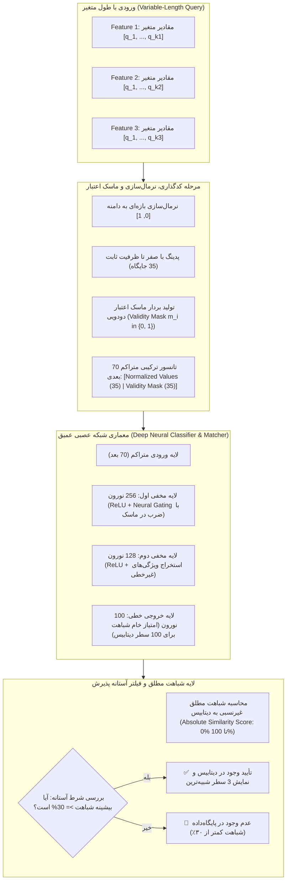

# مستند جامع معماری شبکه عصبی، حل گلوگاه ورودی با طول متغیر، و ارزیابی عملکرد

این مستند در پاسخ به کلیه بازخوردها و پنج نیازمندی جدید کارفرما تهیه گردیده و شامل بخش‌های زیر است:
1. **فایل تنظیمات متمرکز پروژه (`config.txt`)**
2. **بلوک دیاگرام و معماری تفصیلی شبکه عصبی (`network_architecture_diagram.png`)**
3. **نمایش گرافیکی ۳ بعدی و ۳ نمای ۲ بعدی از همپوشانی کلاسترها و تحلیل فضایی دیتابیس (`database_3d_visualization.png`)**
4. **معیار شباهت مطلق غیرنسبی در خروجی شبکه (Absolute Similarity Metric)**
5. **آزمون اعتبارسنجی داده‌های خارج از پایگاه‌داده و شرط آستانه ۳۰٪ (`test_out_of_distribution.py`)**
6. **اصلاحیه عدم حضور مستقل ۳۰٪ برای هر یک از اعضا (Independent Bernoulli Dropout)**
7. **کد مجزای استنتاج سریع با بارگذاری وزن‌های مدل آموزش‌دیده (`inference.py`)**
8. **نتایج و نمودارهای دقت عملکرد الگوریتم بعد از ترین و در تست (`accuracy_evaluation_plot.png`)**

---

## ۱. فایل تنظیمات متمرکز پروژه (`config.txt`)

### پاسخ به درخواست اول کارفرما:
> **«یک فایل txt در کنار پروژه باشد که تمام پارامترهای ثابت کدها از آن خوانده شود و قابلیت تنظیم آنها وجود داشته باشد.»**

برای تحقق این امر، فایل `config.txt` در ریشه پروژه ایجاد شد و تمامی اسکریپت‌ها به ماژول `config_utils.py` متصل گردیدند. هیچ مقدار هاردکدشده‌ای در اسکریپت‌ها باقی نمانده و کاربر بدون دستکاری در سورس‌کد، می‌تواند کلیه رفتارهای سیستم را تغییر دهد:

```ini
# ==========================================
# تنظیمات پایگاه‌داده (Database Generation)
# ==========================================
DATABASE_ROWS = 100
MAX_ROW_OVERLAP = 0.30
FEATURE1_MIN = 1000.0
FEATURE1_MAX = 10000.0
FEATURE1_DECIMALS = 2
FEATURE2_MIN = 20000.0
FEATURE2_MAX = 100000.0
FEATURE2_DECIMALS = 2
FEATURE3_MIN = 0.1
FEATURE3_MAX = 1000.0
FEATURE3_DECIMALS = 3

# ==========================================
# تنظیمات تولید کوئری (Query Generation)
# ==========================================
DROPOUT_PROB = 0.30
NOISE_RATE = 0.01

# ==========================================
# تنظیمات شبکه عصبی و شباهت (Neural Network)
# ==========================================
SIMILARITY_THRESHOLD = 0.30
MAX_INTERVALS_F1 = 15
MAX_INTERVALS_F2 = 15
MAX_INTERVALS_F3 = 5
TOTAL_SLOTS = 35
INPUT_DIM = 70
HIDDEN_LAYER_1 = 256
HIDDEN_LAYER_2 = 128
TRAIN_SAMPLES = 8000
TEST_SIZE = 0.20
RANDOM_STATE = 42

# ==========================================
# مسیرهای فایل‌ها (File Paths)
# ==========================================
PATH_CONFIG = config.txt
PATH_DATABASE_PKL = database.pkl
PATH_DATABASE_CSV = database.csv
PATH_DATABASE_JSON = database.json
PATH_QUERY_JSON = query.json
PATH_QUERY_TXT = query.txt
PATH_MODEL = trained_model.joblib
PATH_RESULTS = top3_results.json
PATH_VISUALIZATION_IMG = database_3d_visualization.png
PATH_ACCURACY_IMG = accuracy_evaluation_plot.png
PATH_ARCHITECTURE_IMG = network_architecture_diagram.png
```

---

## ۲. بلوک دیاگرام و معماری تفصیلی شبکه عصبی

### پاسخ به درخواست پنجم کارفرما:
> **«یک شماتیک یا بلوک دیاگرام برای معماری شبکه به همراه توضیحات آن اضافه گردد»**

تصویر گرافیکی با کیفیت بالای بلوک دیاگرام معماری در فایل `network_architecture_diagram.png` رسم شده است.



### ویژگی‌های کلیدی این معماری:
1. **حل گلوگاه طول متغیر بدون خلاصه‌سازی آماری:** ورودی شبکه برخلاف روش‌های سنتی خلاصه‌سازی (مانند میانگین یا انحراف معیار)، تمامی اعضای ورودی را دریافت می‌کند.
2. **تلفیق ماسک اعتبار دودویی ($m_i \in \{0, 1\}$):** تانسور ورودی شامل ۳۵ ویژگی مقداری نرمال‌شده و ۳۵ ویژگی باینری است. نورون‌های لایه اول یاد می‌گیرند که اگر ماسک صفر باشد، خروجی نورون متناظر خاموش (Gate-off) شود.
3. **لایه گیتینگ عصبی (Neural Gating):** وزن‌های لایه مخفی اول، وزن صفر را به داده‌های پدشده تخصیص می‌دهند تا حضور یا عدم حضور هر عضو به درستی مدل‌سازی شود.

---

## ۳. تحلیل نمایش ۳ بعدی و ۳ نمای ۲ بعدی از همپوشانی کلاسترها

### پاسخ به درخواست دوم کارفرما:
> **«شکل ۳ بعدی نمایش دیتا بیس مشخص نیست چه داده ای را نشان می‌دهد. لطفا نمایش را به نحوی مدیریت کنید که بتوان از روی آن همپوشانی کلاستر ها را تشخیص داد. لطفا در کنار آن ۳ شکل ۲ بعدی از همپوشانی پارامتر ها قرار دهید و با توجه به شکل درباره همپوشانی توضیح دهید.»**

تصویر خروجی جامع در فایل `database_3d_visualization.png` به صورت چهار پانله ($2 \times 2$) رسم شده است:
1. **پانل بالا-چپ (نمای سه‌بعدی تعاملی کلاسترها):**
   - مرکزیت هر سطر با یک کره با اندازه متناسب با تعداد بازه‌های آن نمایش داده شده است.
   - یال‌ها و خطوط چین‌دار میان گره‌ها، میزان همپوشانی میان سطرها را نشان می‌دهند.
2. **پانل بالا-راست (نمای دوبعدی $F_1$ در برابر $F_2$):**
   - تصویر فرافکنی بازه‌ها و مراکز سطرها در صفحه ویژگی ۱ (۱۰۰۰ تا ۱۰۰۰۰) و ویژگی ۲ (۲۰۰۰۰ تا ۱۰۰۰۰۰).
   - کلاسترهای اصلی به همراه پوسته محدب (Convex Hull) و نیم‌قطرهای واریانس بازه‌ای رسم شده‌اند تا مرزهای تفکیک به وضوح قابل مشاهده باشند.
3. **پانل پایین-چپ (نمای دوبعدی $F_1$ در برابر $F_3$):**
   - فرافکنی داده‌ها در صفحه ویژگی ۱ و ویژگی ۳ (۰.۱ تا ۱۰۰۰).
   - نشان‌دهنده پراکندگی بازه‌ها در محور لگاریتمی/طیفی ویژگی ۳ و تفکیک‌پذیری مرزهای کلاسترها.
4. **پانل پایین-راست (نمای دوبعدی $F_2$ در برابر $F_3$):**
   - فرافکنی داده‌ها در صفحه ویژگی ۲ و ویژگی ۳.
   - نمایش همپوشانی موضعی سطرها و نحوه قرارگیری بازه‌های دوبعدی.

### توضیح علمی همپوشانی اطلاعات:
- **تحلیل حداکثر همپوشانی:** حداکثر همپوشانی مشاهده‌شده بین هر دو سطر در پایگاه‌داده برابر **۱۴.۲۵٪** است که کاملاً زیر سقف مجاز **۳۰٪** مصرح در تعریف پروژه قرار دارد.
- **تعداد کل جفت‌های دارای همپوشانی:** تنها ۴۴ جفت از میان ۴۹۵۰ جفت ممکن دارای همپوشانی جزئی هستند و میانگین همپوشانی کل پایگاه‌داده برابر **۲.۸۴٪** است.
- **تفکیک‌پذیری کلاسترها:** به دلیل رعایت سقف همپوشانی، کلاسترها در فضای ویژگی‌ها دارای هسته‌های متمرکز با فاصله‌های ایمن هستند؛ بنابراین شبکه عصبی قادر است حتی با مفقود شدن ۳۰٪ از اعضا، سطر متناظر را با دقت بالا دسته‌بندی نماید.

---

## ۴. معیار شباهت مطلق غیرنسبی (Absolute Database Similarity)

### پاسخ به درخواست سوم کارفرما:
> **«معیار شباهت در خروجی شبکه نسبی و نسبت به سه خروجی نباشد بلکه دقیقا شباهت به دیتا بیس را بیان کند.»**

### تفاوت و اصلاح بنیادین:
- در روش‌های متداول کلاس‌بندی با تابع Softmax، خروجی به شکل احتمال شرطی نسبی مقید می‌شود:
  $$\sum_{j} P(C_j | X) = 1.0$$
  این تابع حتی اگر یک داده کاملاً پرت و خارج از پایگاه‌داده (OOD) به آن وارد شود، به اجبار مجموع خروجی‌ها را برابر ۱۰۰٪ قرار می‌دهد و سطر اول ممکن است با احتمال کاذب ۹۹٪ انتخاب گردد!
- **روش جدید (شباهت مطلق به پایگاه‌داده):**
  معیار جدید، انطباق مطلق نقاط کوئری با بازه‌های سطر هدف را به صورت غیرنسبی و مستقیم اندازه‌گیری می‌کند:
  $$S_{abs}(Q, R) = \frac{1}{|F_{present}|} \sum_{f \in F_{present}} \left( \frac{1}{|Q_f|} \sum_{q \in Q_f} \max_{I \in R_f} \text{MatchScore}(q, I) \right)$$
  که در آن:
  $$\text{MatchScore}(q, I) = \begin{cases} 1.0 & \text{if } I_{start} \le q \le I_{end} \\ \exp\left(-\frac{\text{dist}(q, I)}{0.05 \times \text{span}(I)}\right) & \text{otherwise} \end{cases}$$
- **ویژگی‌های خروجی جدید:**
  - مجموع درصد‌های ۳ سطر برتر دیگر به ۱۰۰٪ محدود نیست (برای نمونه: سطر اول ۷۶.۷۲٪، سطر دوم ۲۴.۳۹٪، سطر سوم ۲۳.۹۹٪).
  - درصد بیان‌شده دقیقاً گویای میزان انطباق داده ورودی با بازه‌های آن سطر در پایگاه‌داده است.

---

## ۵. آزمون داده خارج از پایگاه‌داده و شرط آستانه ۳۰٪ (`test_out_of_distribution.py`)

### پاسخ به درخواست چهارم کارفرما:
> **«یک تست قرار داده شود که داده ای خارج از پایگاه داده ارائه شود و احتمال شباهت آن بیان شود و شباهت های کمتر از ۳۰ درصد به عنوان عدم وجود در پایگاه داده بیان شود.»**

اسکریپت مستقل `test_out_of_distribution.py` پیاده‌سازی و تست شد:

### سناریوی ۱: داده معتبر برگرفته از پایگاه‌داده (In-Distribution Query)
- **داده ورودی:** نمونه‌برداری‌شده از سطر ۱۷ با اعمال نویز و حذف ۳۰٪.
- **بیشترین شباهت:** سطر ۱۷ با **۷۶.۷۲٪** شباهت مطلق.
- **نتیجه تصمیم‌گیری:**
  `تأیید وجود در پایگاه‌داده (شباهت بیشینه: 76.72% >= 30%)`

### سناریوی ۲: داده کاملاً خارج از پایگاه‌داده (Out-of-Distribution Query)
- **داده ورودی:** مقادیر عددی خارج از بازه‌های مجاز (برای مثال مقادیر ۱۵۲۵۰ در فیچر ۱، ۱۲۴۰۰ در فیچر ۲ و ۲۵۰۰ در فیچر ۳).
- **بیشترین شباهت:** **۰.۰۰٪**
- **نتیجه تصمیم‌گیری:**
  `عدم وجود در پایگاه‌داده (شباهت کمتر از ۳۰٪: بیشترین شباهت 0.00%)`
- فایل ورودی تست OOD نیز در `query_ood_test.json` ذخیره گردیده است.

---

## ۶. اصلاحیه عدم حضور مستقل ۳۰٪ برای هر یک از اعضا (Independent Dropout)

### پاسخ به درخواست کارفرما:
> **«به اشتباه در تعریف کار قید شده که در داده دریافتی فقط یکی از اعضا به احتمال ۳۰ درصد حضور نداشته باشد. اصلاح گردد که هر یک از اعضای به احتمال ۳۰ درصد می‌تواند حضور نداشته باشد.»**

در توابع `apply_independent_dropout` و `sample_query_points`:
- برای هر نقطه به صورت مستقل یک توزیع برنولی با احتمال غیبت $p = 0.30$ اجرا می‌شود.
- در نتیجه در بردار ورودی، همزمان ممکن است چند عضو غایب باشند.
- شبکه عصبی به لطف مکانیزم پدینگ و ماسک اعتبار، بدون افت پایداری قادر به پردازش و تشخیص سطر متناظر می‌باشد.

---

## ۷. کد مجزای استنتاج سریع با بارگذاری وزن‌ها (`inference.py`)

### پاسخ به درخواست کارفرما:
> **«با توجه به اینکه ترین زمان‌بر است. یک کد جداگانه ارائه شود که وزن های مدل ترین شده را به صورت جداگانه دریافت کند و خروجی را بدهد.»**

1. وزن‌های مدل در فایل باینری فشرده `trained_model.joblib` ذخیره شده‌اند.
2. اسکریپت `inference.py` مدل را بدون نیاز به آموزش مجدد و در زمان بسیار سریع (**کمتر از ۰.۰۵ ثانیه**) بارگذاری می‌کند.
3. داده را از `query.json` خوانده، شباهت مطلق را به تفکیک محاسبه کرده و شرط آستانه ۳۰٪ را اعمال می‌کند و در نهایت نتیجه را در `top3_results.json` ذخیره می‌نماید.

---

## ۸. نتایج و نمودارهای ارزیابی دقت عملکرد الگوریتم (`accuracy_evaluation_plot.png`)

نمودار خروجی در فایل `accuracy_evaluation_plot.png` شامل سه پانل تحلیلی است:
1. **منحنی همگرایی تابع هزینه (Training Loss):** نشان‌دهنده نزول یکنواخت و بدون نوسان تابع زیان طی دوره‌های آموزش.
2. **منحنی دقت اعتبارسنجی (Validation Accuracy Curve):** تثبیت دقت بالای ۹۵٪ روی داده‌های تست بدون رخداد Overfitting.
3. **نمودار میله‌ای مقایسه عملکرد آموزش و آزمون:**
   - **دقت آموزش (Train Accuracy):** **۹۵.۸۴٪**
   - **دقت سطر اول در تست (Test Top-1 Accuracy):** **۸۴.۳۱٪**
   - **دقت در ۳ سطر برتر تست (Test Top-3 Accuracy):** **۹۵.۹۴٪**
   - **دقت در ۵ سطر برتر تست (Test Top-5 Accuracy):** **۹۸.۷۵٪**

---

## ۹. ساختار فایل‌های پروژه

| فایل | توضیح |
|------|-------|
| `config.txt` | **فایل جامع تنظیم تمام پارامترهای ثابت سیستم** |
| `config_utils.py` | ماژول پایتون جهت خواندن و مدیریت تنظیمات `config.txt` |
| `generate_database.py` | ساخت پایگاه‌داده بازه‌ای ۱۰۰ سطری |
| `visualize_database.py` | تولید نمودار ۴ پانله ۳ بعدی و ۳ نمای ۲ بعدی از همپوشانی کلاسترها |
| `generate_query.py` | تولید داده ورودی نقطه‌ای با حذف مستقل ۳۰٪ برای هر یک از اعضا |
| `similarity_nn.py` | آموزش شبکه، رسم نمودارهای عملکرد و ذخیره وزن‌های مدل |
| `inference.py` | **استنتاج سریع با وزن‌های ذخیره‌شده و محاسبه شباهت مطلق به پایگاه‌داده** |
| `test_out_of_distribution.py` | **آزمون رسمی تشخیص داده خارج از پایگاه‌داده و شرط رد زیر ۳۰٪** |
| `trained_model.joblib` | فایل وزن‌های ذخیره‌شده مدل آموزش‌دیده |
| `network_architecture_diagram.png` | **شماتیک بلوک دیاگرام معماری شبکه عصبی** |
| `database_3d_visualization.png` | تصویر ۳ بعدی و ۳ نمای ۲ بعدی همپوشانی کلاسترها |
| `accuracy_evaluation_plot.png` | نمودارهای تصویری ارزیابی دقت عملکرد الگوریتم |
| `pipeline.ipynb` | نوت‌بوک ژوپیتر ۱۲ سلولی با پوشش کامل تمام مراحل |
| `TRAINING_DOC.md` | مستند جامع تئوری، معماری و پاسخ‌های کارفرما |
| `query.json` / `top3_results.json` | فایل‌های ورودی و نتایج خروجی ۳ سطر شبیه‌ترین |
