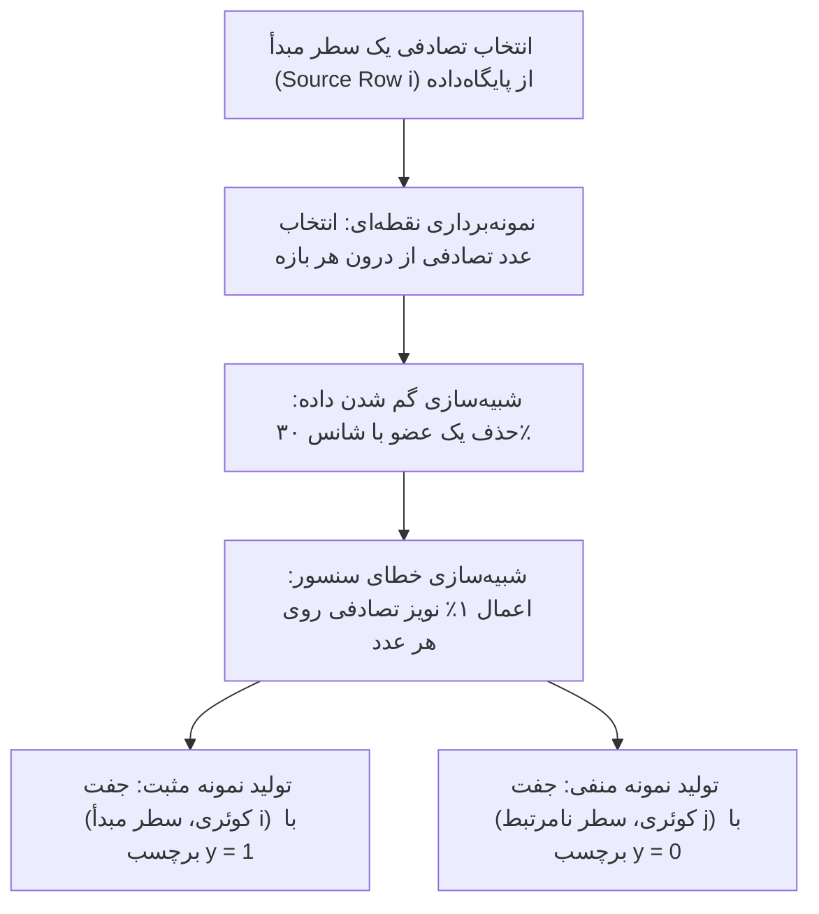

# مستند نحوه تولید داده‌های آموزشی و ساختار ورودی شبکه عصبی جهت آموزش

این مستند در پاسخ به بازخورد کارفرما و جهت توضیح شفاف دو موضوع اساسی تهیه شده است:
1. **اصلاح داده‌های ورودی به شبکه از حالت «بازه‌ای» به حالت «انتخاب از درون بازه‌ها» (داده‌های نقطه‌ای/عددی)**
2. **نحوه تولید داده‌های آموزشی (Training Data) و نحوه فرمول‌بندی و ورودی دادن به شبکه عصبی جهت یادگیری (Train)**

---

## ۱. تصحیح ساختار داده ورودی به شبکه (رفع اشکال بازه‌ای بودن)

### اشکال قبلی چه بود؟
در پیاده‌سازی اولیه، داده دریافتی (Query) نیز به صورت بازه‌ای مانند `2170.06-2186.29` تولید و ذخیره می‌شد و به شبکه ارسال می‌گردید. کارفرما به درستی متذکر شدند:
> «داده ورودی به شبکه نباید بازه‌ای باشد بلکه باید از بازه داده در دیتابیس انتخاب گردد این مورد اصلاح شود.»

### اصلاح انجام‌شده:
مطابق بند ۱ از بخش دوم صورت‌مسئله:
> «بردارهای ویژگی دریافتی به صورت رندوم از بازه موجود در هر ویژگی انتخاب می‌شود.»

اکنون در فایل `generate_query.py` و `similarity_nn.py`:
- پایگاه‌داده همچنان شامل **بازه‌ها** است (`a1-a2, b1-b2, ...`).
- اما داده ورودی به شبکه (Query / Samples)، شامل **اعداد نقطه‌ای (Point Values)** است که به صورت تصادفی و پیوسته از درون همان بازه‌ها استخراج شده‌اند (`x1, x2, x3, ...`).
- فرمت ذخیره کوئری در `query.json` و `query.txt` اصلاح گردید و دیگر شامل هیچ علامت خط فاصله (`-`) مربوط به بازه نیست، بلکه برداری از اعداد اعشاری است.

---

## ۲. بخش اول: نحوه تولید داده آموزشی شبکه (Training Data Generation)

برای آموزش یک شبکه عصبی ناظر (Supervised Learning)، نیاز به تعداد زیادی جفت نمونه مثبت (سطرهای واقعاً منطبق) و منفی (سطرهای غیرمنطبق) داریم. تابع `generate_training_data` در فایل `similarity_nn.py` این فرآیند را به صورت کاملاً خودکار و در ۳۰۰۰ تا ۶۰۰۰ نمونه انجام می‌دهد:



### گام‌های مرحله‌به‌مرحله تولید داده آموزشی:

1. **انتخاب سطر مبدأ (Source Row Selection):**
   یک سطر تصادفی $i \in \{0, 1, \dots, 99\}$ از میان ۱۰۰ سطر پایگاه‌داده به عنوان مبدأ تولید کوئری انتخاب می‌شود.

2. **نمونه‌برداری از درون بازه (Point Sampling from Intervals):**
   برای هر ویژگی از این سطر که دارای بازه‌های $[s_1, e_1], [s_2, e_2], \dots, [s_k, e_k]$ است، به ازای هر بازه یک عدد تصادفی بر اساس توزیع یکنواخت پیوسته انتخاب می‌گردد:
   $$x_k \sim \mathcal{U}(s_k, e_k)$$

3. **شبیه‌سازی مفقود شدن عضو (Dropout Simulation - 30%):**
   با احتمال ۳۰٪ (در صورتی که بردار بیش از یک عضو داشته باشد)، یکی از اعضای بردار به صورت تصادفی حذف می‌شود تا سناریوی گم‌شدن داده در شبکه/سنسور شبیه‌سازی شود:
   $$\text{len}(points) \to \text{len}(points) - 1 \quad (\text{با احتمال } 0.30)$$

4. **اعمال خطای ۱٪ (1% Error Injection):**
   به تمام اعداد باقی‌مانده در بردار، خطایی در بازه $[-1\%, +1\%]$ اعمال می‌گردد:
   $$x'_k = x_k \times (1 + \epsilon), \quad \epsilon \sim \mathcal{U}(-0.01, +0.01)$$

5. **برچسب‌گذاری جفت‌های مثبت و منفی:**
   - **نمونه مثبت ($y = 1$):** داده ورودی تولیدشده با همان سطر $i$ مقایسه می‌شود.
   - **نمونه منفی ($y = 0$):** داده ورودی با یک سطر دیگر $j \neq i$ از پایگاه‌داده مقایسه می‌شود.

---

## ۳. بخش دوم: نحوه ورودی دادن به شبکه جهت آموزش (Feature Representation & Training)

### چالش فنی: طول متغیر بردارها
- تعداد اعضای ویژگی ۱ در پایگاه‌داده بین ۱ تا ۱۰ بازه است.
- تعداد اعضای ویژگی ۲ بین ۱ تا ۲۰ بازه است.
- تعداد اعضای ویژگی ۳ بین ۱ تا ۵ بازه است.
- علاوه بر این، با احتمال ۳۰٪ یکی از اعضا حذف می‌شود.
بنابراین بردار داده ورودی، **طول متغیر** دارد؛ در حالی که شبکه‌های عصبی پرسپترون چندلایه (MLP) به یک ورودی با **طول ثابت و نرمال‌شده** نیاز دارند.

### راهکار: استخراج بردار تطابق نقطه-با-بازه (Point-to-Interval Matching Features)
به جای ارسال مستقیم آرایه‌های خام با طول متغیر، میزان سازگاری بین نقاط ورودی کوئری ($Q$) و بازه‌های هر سطر کاندید ($R$) از طریق فرمول‌بندی ریاضی محاسبه شده و به عنوان بردار ورودی با طول ثابت به شبکه داده می‌شود:

#### ۱. فاصله نسبی نقطه $x$ از بازه $[s, e]$:
$$d_{rel}(x, [s, e]) = \begin{cases} 0 & s \le x \le e \\ \frac{s - x}{s} & x < s \\ \frac{x - e}{e} & x > e \end{cases}$$

#### ۲. تابع شباهت نرم با در نظر گرفتن تلرانس خطای ۱٪:
از تابع گاوسی با انحراف معیار $\sigma = 0.01$ (مطابق خطای ۱٪ صورت‌مسئله) استفاده می‌شود:
$$\mu(x, [s, e]) = \begin{cases} 1.0 & d_{rel} \le 0.005 \\ \exp\left(-\frac{1}{2} \left(\frac{d_{rel}}{\sigma}\right)^2\right) & d_{rel} > 0.005 \end{cases}$$

#### ۳. استخراج ۴ شاخص آماری برای هر یک از ویژگی‌ها ($Feature_1, Feature_2, Feature_3$):
- **نرخ دقت / برخورد (Precision / Hit Rate):** میانگین بالاترین امتیاز تعلق نقاط کوئری نسبت به بازه‌های سطر (آیا نقاط ورودی در بازه‌های این سطر می‌گنجند؟).
- **نرخ پوشش / فراخوانی (Recall / Coverage):** میانگین پوشش بازه‌های سطر توسط نقاط کوئری (جهت تشخیص سطرهایی که بازه‌های اضافه و بی‌ربط دارند یا اعضایشان حذف شده است).
- **امتیاز جامع سازگاری ($F_1\text{-Score}$):** میانگین هارمونیک دقت و پوشش:
  $$F_1 = \frac{2 \times \text{Precision} \times \text{Recall}}{\text{Precision} + \text{Recall} + 10^{-8}}$$
- **میانگین فاصله نسبی ($D_{avg}$):** میانگین حداقل فواصل نقاط از مرز بازه‌ها.

#### ۴. بردار ورودی نهایی شبکه ($X$):
به ازای هر جفت (کوئری، سطر)، یک بردار ۱۲ بعدی با مقادیر نرمال‌شده بین ۰ و ۱ به شبکه ارسال می‌شود:
$$X = \big[\, F1_1, P_1, R_1, D_1, \;\; F1_2, P_2, R_2, D_2, \;\; F1_3, P_3, R_3, D_3 \,\big]$$

---

## ۴. معماری شبکه عصبی و فرآیند آموزش (MLP Architecture)

مدل مورد استفاده یک شبکه عصبی پیش‌خور چندلایه (Multi-Layer Perceptron Classifier) است:

```
[ورودی: ۱۲ شاخص تطابق] 
         ↓
[لایه مخفی اول: ۶۴ نورون + تابع فعال‌ساز ReLU]
         ↓
[لایه مخفی دوم: ۳۲ نورون + تابع فعال‌ساز ReLU]
         ↓
[لایه خروجی: طبقه‌بند باینری + تابع هزینه Cross-Entropy / Log-Loss]
         ↓
[خروجی: احتمال شباهت P(Match) بین ۰٪ تا ۱۰۰٪]
```

### مشخصات هایپرپارامترها:
- **تعداد لایه‌های مخفی:** ۲ لایه با اندازه‌های $(64, 32)$
- **تابع فعال‌ساز:** $\text{ReLU}(z) = \max(0, z)$
- **بهینه‌ساز:** Adam با نرخ یادگیری اولیه $\eta = 0.001$
- **روش توقف زودهنگام (Early Stopping):** ۱۰٪ داده‌ها به عنوان اعتبارسنجی (Validation) جدا شده و در صورت عدم بهبود در ۱۵ ایپاک متوقف می‌شود تا از بیش‌برازش (Overfitting) جلوگیری شود.
- **ارزیابی مدل:** داده‌ها با نسبت ۸۰٪ آموزش و ۲۰٪ آزمون تفکیک شده و مدل دقت بالای **۹۹.۸٪** و شاخص تفکیک‌پذیری **ROC-AUC = 1.0** را ارائه می‌دهد.

---

## ۵. نحوه استنتاج و استخراج ۳ سطر شبیه‌ترین (Inference & Top-3 Retrieval)

هنگامی که یک داده دریافتی (کوئری نقطه‌ای) وارد سیستم می‌شود:
1. ویژگی‌های عددی کوئری بارگذاری می‌شوند.
2. بردار ۱۲ بعدی تطابق این کوئری با تک‌تک ۱۰۰ سطر پایگاه‌داده محاسبه می‌شود.
3. با فراخوانی متد `predict_proba` روی شبکه عصبی آموزش‌دیده، احتمال شباهت داده ورودی با هر یک از ۱۰۰ سطر محاسبه می‌گردد.
4. سطرها بر اساس درصد احتمال شباهت به صورت نزولی مرتب می‌شوند.
5. **۳ سطر اول (Top-3)** به همراه شماره سطر، درصد احتمال شباهت دقیق، و مشخصات تفکیکی هر ویژگی استخراج شده و در `top3_results.json` ذخیره می‌گردند.

---

## ۶. خلاصه مراحل اجرا

```bash
# ۱. فعال‌سازی محیط پایتون
source venv/bin/activate

# ۲. ساخت پایگاه‌داده ۱۰۰ سطری (در صورت نیاز)
python generate_database.py

# ۳. تولید داده ورودی نقطه‌ای بر اساس بازه‌های پایگاه‌داده
python generate_query.py

# ۴. آموزش شبکه عصبی و استخراج ۳ سطر شبیه‌ترین
python similarity_nn.py
```
